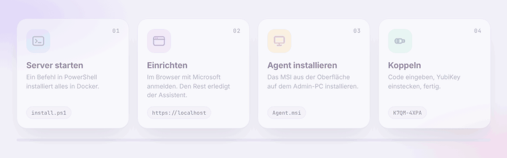

# Yubikey-Lifecycle-Manager

[English](README.md) · **Deutsch**

Selbst hostbare Plattform, mit der IT-Administratoren allein oder im Team den Lebenszyklus von YubiKeys in **Microsoft Entra ID** verwalten.

## Funktionen

- **Tenant-On- und -Offboarding** per Assistent, mit automatischen Checks der FIDO2-Richtlinie und „Jetzt beheben“
- **Inventar:** wer hat welchen Key (Seriennummer, Firmware, Registrierdatum), Lagerbestand, Lebenszyklus, freie Felder und Tags
- **Registrierung on Behalf:** einzeln, massenweise oder als geteilter Key, gesteuert über konfigurierbare Profile (PIN-Strategie, erzwungener PIN-Wechsel, Firmware-Vorgaben)
- **PIN-PDF** mit grafischer Anleitung für den Nutzer
- **Reporting** mit CSV/PDF-Export
- **REST-API** für externe Tools wie Ticketsysteme oder RMM

## Aufbau

| Komponente | Aufgabe |
|---|---|
| Backend + WebGUI | Bedienung, Datenhaltung, Kommunikation mit Microsoft Graph. Selbst hostbar (Docker). |
| Windows-Agent + Tray-App | Zugriff auf den lokal eingesteckten YubiKey (PIN, Registrierung, Auslesen). Status in der Taskleiste. |

Ein reiner Browser kann die Registrierung on Behalf nicht durchführen. Die Begründung steht in der Planung.

## Ausprobieren ohne Entra (Demo)

Mit Docker in einer Minute, mit erfundenen Beispieldaten und ohne Verbindung zu Microsoft:

```bash
git clone https://github.com/PanPakaPancake/Yubikey-Lifecycle-Manager.git
cd Yubikey-Lifecycle-Manager
docker compose -f docker-compose.demo.yml up -d
```

Danach `http://localhost:8099` öffnen und eine Rolle wählen. Details: [Demo](docs/DEMO.md).

## Installation

<picture>
  <source media="(prefers-color-scheme: dark)" srcset="docs/bilder/installation/ablauf-dark.gif">
  
</picture>

Zum Ausprobieren auf einem Windows-PC mit [Docker Desktop](https://www.docker.com/products/docker-desktop/) genügt ein Befehl in PowerShell:

```powershell
irm https://raw.githubusercontent.com/PanPakaPancake/Yubikey-Lifecycle-Manager/main/install.ps1 | iex
```

Danach läuft die Plattform unter `https://localhost`. Einrichten, Agent installieren und koppeln zeigt die **[bebilderte Installationsanleitung](docs/INSTALLATION.md)** Schritt für Schritt.

Für den Betrieb auf einem Linux-Server im internen Netz oder hinter ZTNA:

```bash
curl -fsSL https://raw.githubusercontent.com/PanPakaPancake/Yubikey-Lifecycle-Manager/main/install.sh | sudo bash
```

Alle Varianten, Datensicherung, Updates und Umzug: [Betrieb und Installation](docs/BETRIEB.md). Die Plattform ist nicht dafür gedacht, offen im Internet zu stehen.

## Dokumentation

- [Demo mit Beispieldaten](docs/DEMO.md)
- [Projektplanung](docs/PLANUNG.md)
- [Installationsanleitung mit Bildern](docs/INSTALLATION.md)
- [Betrieb und Installation](docs/BETRIEB.md)
- [Testanleitung V1 (Praxistest mit Tenant und YubiKey)](docs/TESTANLEITUNG-V1.md)
- [Signierung des Agents (SignPath)](docs/SIGNIERUNG.md)

## Projektstruktur

| Pfad | Inhalt |
|---|---|
| `src/Ylm.Server` | ASP.NET-Core-Backend: Einrichtung, Tenants, Inventar, Wizard, PDFs, Reporting, REST-API mit Rechten pro Schlüssel, SignalR-Hub für Agents |
| `src/Ylm.Core` | Fachlogik ohne Abhängigkeiten: Rollen, Lebenszyklus, Profile, Firmware-Hinweise, Richtlinien-Prüfungen, Audit-Hash-Kette |
| `src/Ylm.Agent`, `src/Ylm.Agent.Core` | Windows-Dienst mit Yubico .NET SDK |
| `src/Ylm.Agent.Tray` | Tray-App (WinForms) |
| `web` | Web-Oberfläche (React, TypeScript, Vite) |
| `installer` | MSI für Agent und Tray-App (WiX) |
| `tests` | Unit-Tests und End-to-End-Tests mit simuliertem Key und simuliertem Graph |

## Status

Das Projekt ist in aktiver Entwicklung (Versionen 0.x). Was sich in welcher Version geändert hat, steht in der Oberfläche im **Versionsverlauf** (Klick auf die Versionsangabe) und auf der [Release-Seite](https://github.com/PanPakaPancake/Yubikey-Lifecycle-Manager/releases).

Umgesetzt sind unter anderem: Tenant-On-/Offboarding mit Prüfungen und „Jetzt beheben“, Rollen und Zuständigkeiten, Audit-Log mit Hash-Kette, Entra-Sync, Inventar mit Lager, Partnerlager, Zusatzfeldern, Tags und „Wer hat welchen Key“, Profile mit Firmware-Prüfung, Einzel- und Stapelregistrierung, geteilte Keys und Breakglass mit optionaler Vier-Augen-Freigabe, PIN-Briefe mit eigenem Layout, Passkey-Rollout mit TAP, Yubico-Sicherheitshinweise, Dashboard mit Export, REST-API mit Rechten pro Schlüssel, Webhooks, Mail-Alarme und Mail-Berichte, Whitelabeling sowie Update per Klick für Server und Agent.

Automatisch getestet sind die Fachlogik und der komplette Ablauf im Backend mit simuliertem YubiKey und simuliertem Microsoft Graph. Die Registrierung on Behalf nutzt die Beta-Schnittstelle von Microsoft Graph (`fido2Methods/creationOptions`), die Microsoft noch ändern kann.

Die Liste der YubiKey-AAGUIDs (`src/Ylm.Core/YubicoAaguids.cs`) sollte vor dem produktiven Einsatz mit der von Yubico veröffentlichten Liste abgeglichen werden.

## Code signing policy

Free code signing provided by [SignPath.io](https://about.signpath.io), certificate by [SignPath Foundation](https://signpath.org)

Signiert werden nur die Dateien des Windows-Agents aus den [Releases](https://github.com/PanPakaPancake/Yubikey-Lifecycle-Manager/releases): `YlmAgent.exe`, `YlmTray.exe` und `YubikeyLifecycleManager-Agent.msi`. Sie entstehen ausschließlich in GitHub Actions aus dem Quellcode dieses Repositorys (`.github/workflows/release.yml`); jede Signierung wird von Hand freigegeben. Einrichtung und Ablauf: [Signierung](docs/SIGNIERUNG.md).

Rollen:

- Committers and reviewers: [PanPakaPancake](https://github.com/PanPakaPancake)
- Approvers: [PanPakaPancake](https://github.com/PanPakaPancake)

Änderungen von außen kommen nur per Pull Request und werden vor dem Merge geprüft. Für GitHub und SignPath ist Mehr-Faktor-Anmeldung Pflicht.

Datenschutz: This program will not transfer any information to other networked systems unless specifically requested by the user or the person installing or operating it. Der Agent spricht nur mit dem Server, mit dem er gekoppelt wurde. Der Server spricht mit den Microsoft-Entra-Tenants, Mail-Servern, Webhooks und Ticketsystemen, die der Betreiber einrichtet, und fragt täglich bei der GitHub-API nach neuen Versionen (abschaltbar mit `Ylm__UpdateCheckEnabled=false`, siehe [Betrieb](docs/BETRIEB.md)).

## Mitmachen und Sicherheit

Fehler und Ideen gern als [Issue](https://github.com/PanPakaPancake/Yubikey-Lifecycle-Manager/issues), Beiträge als Pull Request: siehe [CONTRIBUTING.md](CONTRIBUTING.md). Sicherheitslücken bitte **nicht** öffentlich melden, sondern wie in [SECURITY.md](SECURITY.md) beschrieben. Es gilt der [Verhaltenskodex](CODE_OF_CONDUCT.md).

## Lizenz

Copyright (C) 2026 PanPakaPancake und Mitwirkende

Der Yubikey-Lifecycle-Manager steht unter der [GNU Affero General Public License v3.0](LICENSE) (AGPL-3.0-only). Er darf frei genutzt, verändert und weitergegeben werden. Wer eine veränderte Fassung weitergibt oder anderen über das Netz zur Nutzung bereitstellt (z. B. als Dienstleister für Kunden), muss deren Quellcode unter derselben Lizenz zugänglich machen.

## Lizenzen von Abhängigkeiten

PDFsharp ist bewusst auf Version 6.2.4 (MIT) festgelegt; neuere Versionen stehen unter einer anderen Lizenz.

YubiKey ist eine Marke der Yubico AB. Dieses Projekt steht in keiner Verbindung zu Yubico oder Microsoft und wird von ihnen nicht unterstützt.
