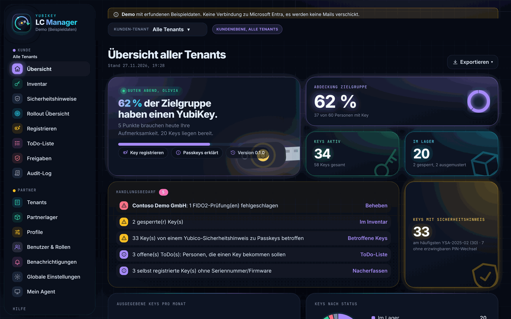
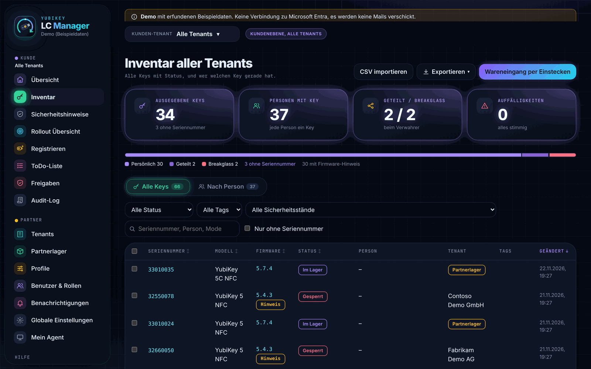
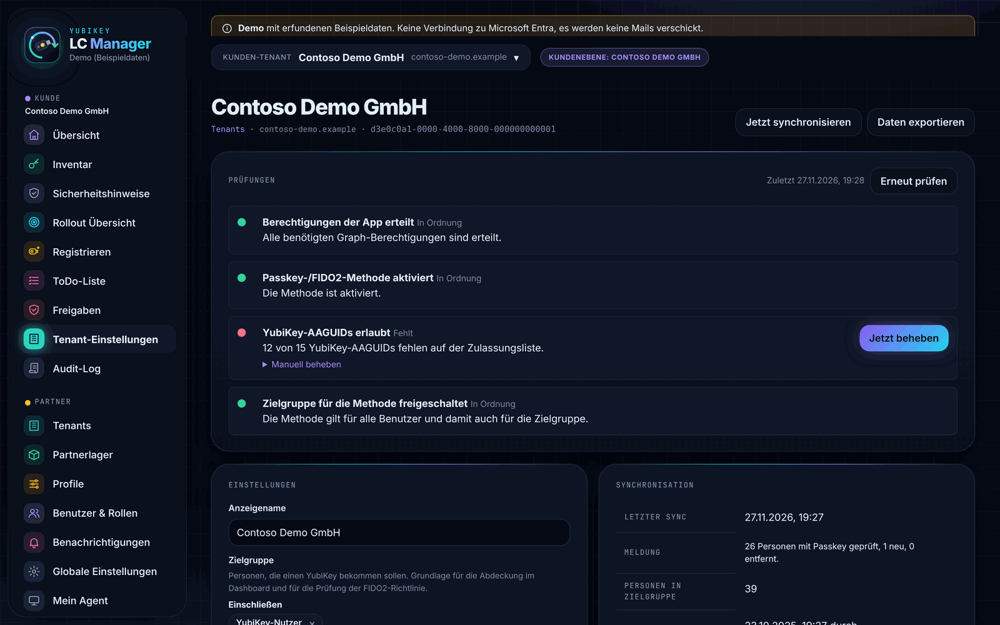
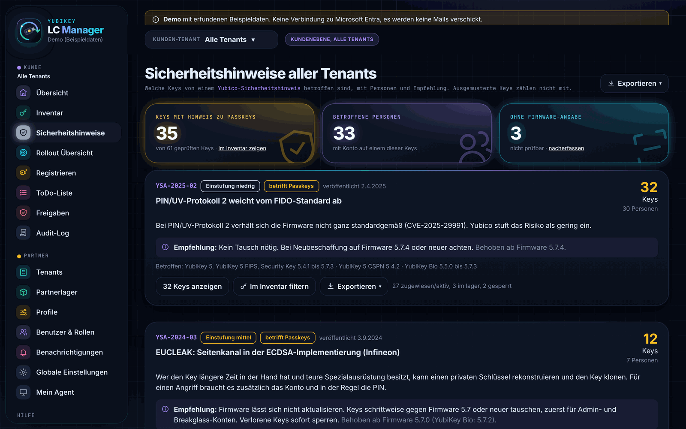

# Yubikey Lifecycle Manager

**English** · [Deutsch](README.de.md)

A self-hosted platform for IT admins who hand out YubiKeys to people in **Microsoft Entra ID**, alone or as a team: inventory, registration on behalf of users, PIN letters, rollout tracking, security advisories and a full audit log, for one or many Entra tenants.



> [!NOTE]
> The user interface and most of the documentation are currently in **German**. English UI support is in progress. All screenshots show the built-in [demo](docs/DEMO.md) with made-up data.

## Features

- **Tenant onboarding and offboarding** with a wizard. The platform checks the tenant's FIDO2 (passkey) policy and fixes missing settings with one click ("Jetzt beheben"), or shows how to fix them by hand.
- **Inventory:** who has which key (serial number, firmware, model, registration date), stock, partner stock for MSPs, lifecycle (in stock, active, locked, retired), custom fields and tags. Keys that users registered themselves are picked up by the Entra sync and can be identified later by plugging them in.
- **Registration on behalf of users:** one by one or in batches (from an Entra group, CSV or search), shared keys and breakglass keys with an optional four-eyes approval. Registration profiles control the PIN strategy, forced PIN change (firmware 5.7+), minimum firmware and factory reset.
- **PIN letters** as PDF with a visual guide for the end user, in your own layout and branding.
- **Passkey rollout overview:** who already signs in with a passkey, who only has classic MFA, who has nothing. Create Temporary Access Passes and remove old methods.
- **Yubico security advisories:** which keys and people are affected (for example EUCLEAK, YSA-2024-03) and what to do.
- **Roles** (Owner, Operator, Helpdesk, Auditor, custom roles), responsibilities per tenant and a tamper-evident **audit log** (hash chain).
- **Reporting and integrations:** dashboard, CSV/Excel/PDF exports, scheduled mail reports, mail alerts, signed webhooks and a REST API (OpenAPI) with per-key permissions, for ticket systems and RMM tools.
- **Self-hosted:** Docker Compose on a Linux server or a Windows PC, HTTPS via internal CA, your own certificate or an existing reverse proxy, daily encrypted backups and one-click updates.

| Inventory | Passkey rollout |
|---|---|
|  |  |
| **Tenant checks with one-click fix** | **Yubico security advisories** |
|  |  |

## How it works

| Component | Role |
|---|---|
| Server and web UI | Operation, data storage and all calls to Microsoft Graph. Runs in Docker (ASP.NET Core, React, PostgreSQL). |
| Windows agent and tray app | Talks to the YubiKey plugged into the admin's PC: reads serial number and firmware, sets the PIN, performs the registration. Connects outbound to the server. |

A browser alone cannot register a security key on behalf of someone else: the passkey has to be created for Microsoft's relying party (`login.microsoft.com`), and a browser on your own domain can neither do that nor set a PIN or read the serial number. That is why a small agent runs on the admin's Windows PC. Background (German): [project planning](docs/PLANUNG.md).

## Try the demo (no Entra needed)

The demo runs with made-up tenants, people and keys. It never talks to Microsoft and sends no mail.

```bash
git clone https://github.com/PanPakaPancake/Yubikey-Lifecycle-Manager.git
cd Yubikey-Lifecycle-Manager
docker compose -f docker-compose.demo.yml up -d
```

Open `http://localhost:8099` and pick a role. Stop it with `docker compose -f docker-compose.demo.yml down` (add `-v` to wipe the demo data). More: [docs/DEMO.md](docs/DEMO.md).

## Installation

On a Windows PC with [Docker Desktop](https://www.docker.com/products/docker-desktop/) (PowerShell, no admin rights needed):

```powershell
irm https://raw.githubusercontent.com/PanPakaPancake/Yubikey-Lifecycle-Manager/main/install.ps1 | iex
```

On a Linux server in your internal network or behind ZTNA:

```bash
curl -fsSL https://raw.githubusercontent.com/PanPakaPancake/Yubikey-Lifecycle-Manager/main/install.sh | sudo bash
```

Both scripts create a `.env` with random secrets, pull the released images from `ghcr.io`, set up daily encrypted backups and finally print the **backup passphrase** and the **setup token**. Then:

1. Open `https://<address>/setup`, enter the setup token and sign in as a Global Administrator of your Entra tenant. The platform creates its own app registration, certificate and admin consent.
2. Under **Mein Agent** (My agent), download the agent MSI and install it on the admin PC, create a pairing code and pair the tray app with the platform address.

The platform is not meant to be exposed to the internet. Step-by-step guides with pictures (German): [Installation](docs/INSTALLATION.md), [Operations and all install variants](docs/BETRIEB.md).

## Documentation

- [Demo with sample data](docs/DEMO.md)
- [Installation guide with pictures](docs/INSTALLATION.md) (German)
- [Operations: install variants, HTTPS, backup, updates, uninstall](docs/BETRIEB.md) (German)
- [Practical test with a real tenant and YubiKey](docs/TESTANLEITUNG-V1.md) (German)
- [Project planning and design decisions](docs/PLANUNG.md) (German)
- [Code signing of the agent](docs/SIGNIERUNG.md) (German)
- REST API: interactive reference at `/api/docs` on your installation

## Status

The project is under active development (versions 0.x) and used in practice. What changed in each version is shown in the app (click the version number) and on the [releases page](https://github.com/PanPakaPancake/Yubikey-Lifecycle-Manager/releases).

Business logic and the complete backend flow are covered by automated tests with a simulated YubiKey and a simulated Microsoft Graph. Registration on behalf of users uses Microsoft Graph's beta endpoint (`fido2Methods/creationOptions`), which Microsoft may still change.

## Contributing

Bug reports, ideas and pull requests are welcome, in English or German. See [CONTRIBUTING.md](CONTRIBUTING.md) for the development setup. Please follow the [Code of Conduct](CODE_OF_CONDUCT.md).

**Security issues:** please do not open a public issue. Report them privately as described in [SECURITY.md](SECURITY.md).

## Project structure

| Path | Contents |
|---|---|
| `src/Ylm.Server` | ASP.NET Core backend: setup, tenants, inventory, registration, PDFs, reporting, REST API, SignalR hub for agents, demo mode |
| `src/Ylm.Core` | Business logic without dependencies: roles, lifecycle, profiles, firmware advisories, policy checks, audit hash chain |
| `src/Ylm.Agent`, `src/Ylm.Agent.Core` | Windows service using the Yubico .NET SDK |
| `src/Ylm.Agent.Tray` | Tray app (WinForms) |
| `web` | Web UI (React, TypeScript, Vite) |
| `installer` | MSI for agent and tray app (WiX) |
| `tests` | Unit tests and end-to-end tests with a simulated key and simulated Graph |

## Code signing policy

Free code signing provided by [SignPath.io](https://about.signpath.io), certificate by [SignPath Foundation](https://signpath.org)

Only the files of the Windows agent from the [releases](https://github.com/PanPakaPancake/Yubikey-Lifecycle-Manager/releases) are signed: `YlmAgent.exe`, `YlmTray.exe` and `YubikeyLifecycleManager-Agent.msi`. They are built exclusively in GitHub Actions from the source code of this repository (`.github/workflows/release.yml`); every signing request is approved manually. Setup and process: [docs/SIGNIERUNG.md](docs/SIGNIERUNG.md).

Roles:

- Committers and reviewers: [PanPakaPancake](https://github.com/PanPakaPancake)
- Approvers: [PanPakaPancake](https://github.com/PanPakaPancake)

External changes come in only as pull requests and are reviewed before merging. Multi-factor authentication is required for GitHub and SignPath.

Privacy policy: This program will not transfer any information to other networked systems unless specifically requested by the user or the person installing or operating it. The agent only talks to the server it was paired with. The server talks to the Microsoft Entra tenants, mail servers, webhooks and ticket systems the operator sets up, and checks the GitHub API once a day for new versions (can be turned off with `Ylm__UpdateCheckEnabled=false`, see [operations](docs/BETRIEB.md)).

## License

Copyright (C) 2026 PanPakaPancake and contributors

Yubikey Lifecycle Manager is licensed under the [GNU Affero General Public License v3.0](LICENSE) (AGPL-3.0-only). You may use, modify and share it freely. If you distribute a modified version or make it available to others over a network (for example as a service provider for customers), you must make its source code available under the same license.

PDFsharp is deliberately pinned to version 6.2.4 (MIT); newer versions use a different license.

YubiKey is a trademark of Yubico AB. This project is not affiliated with or endorsed by Yubico or Microsoft.
