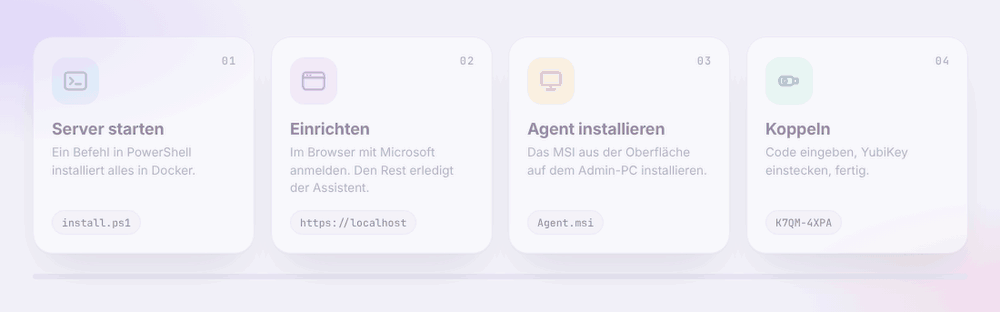
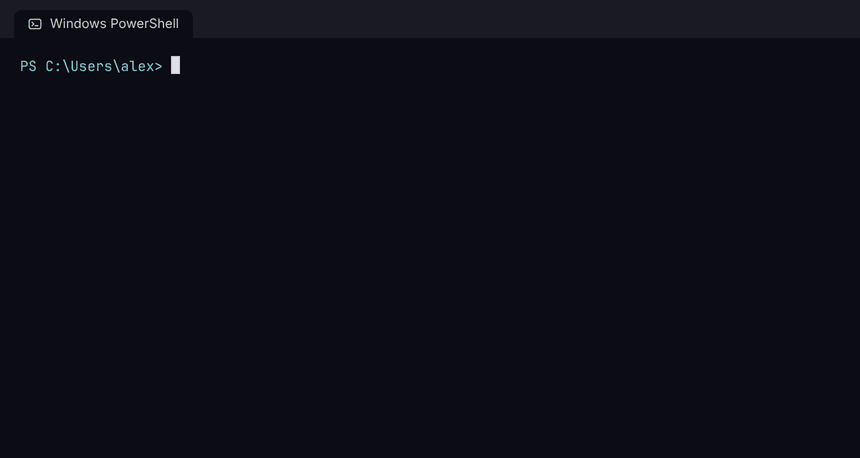
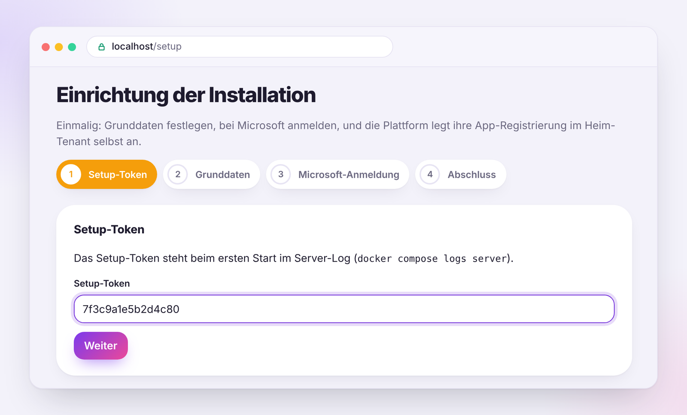
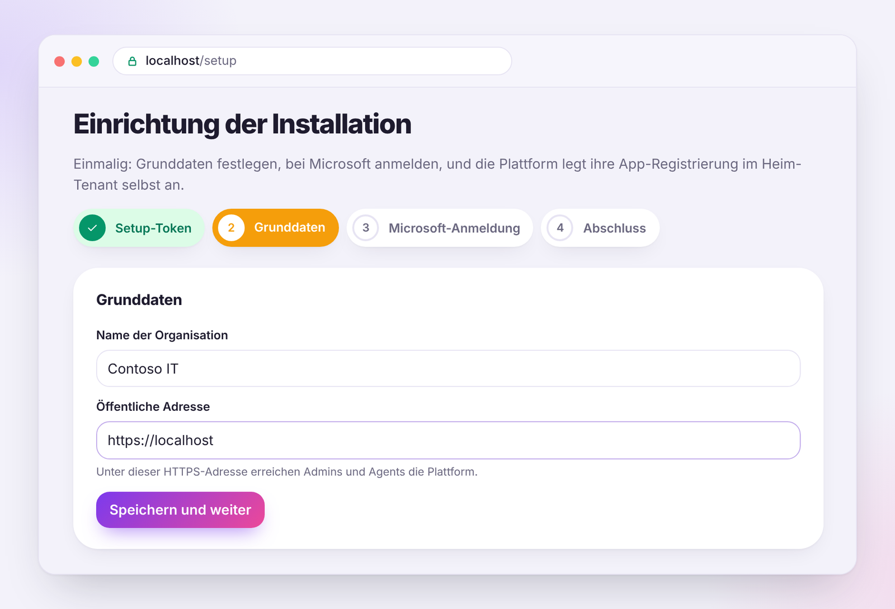
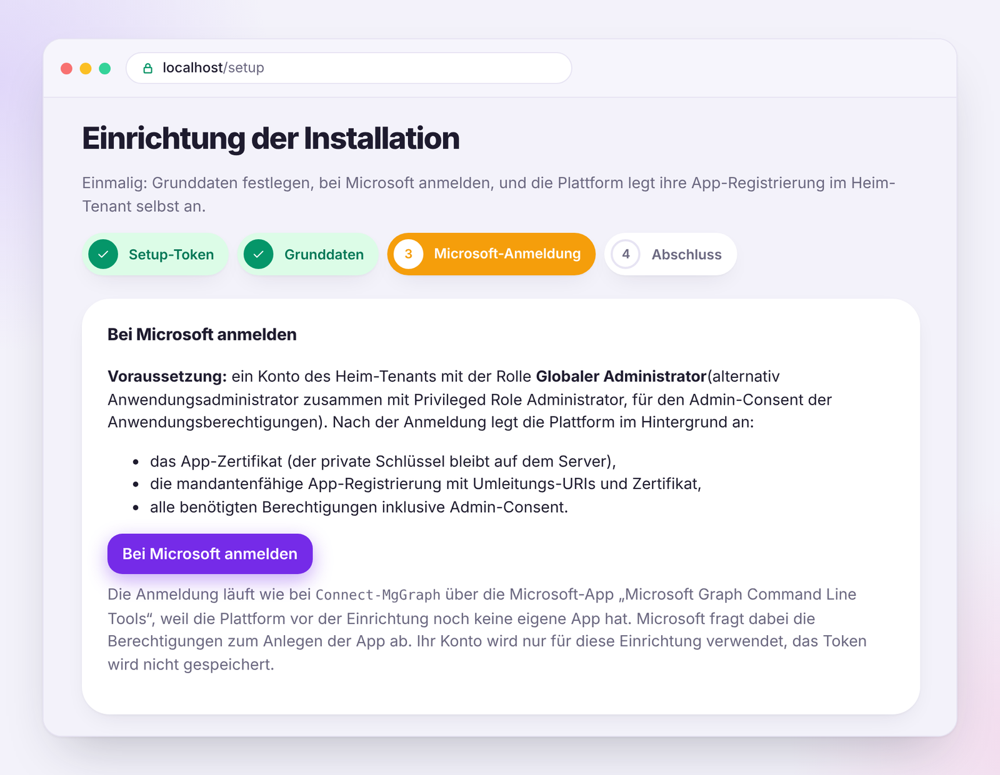
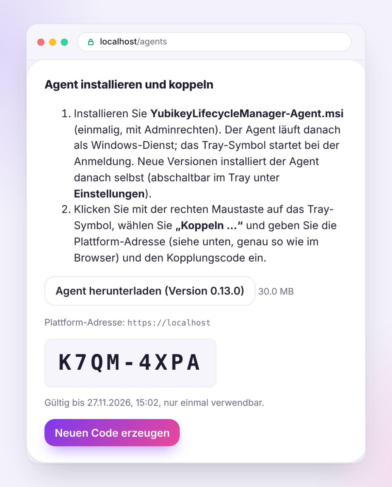
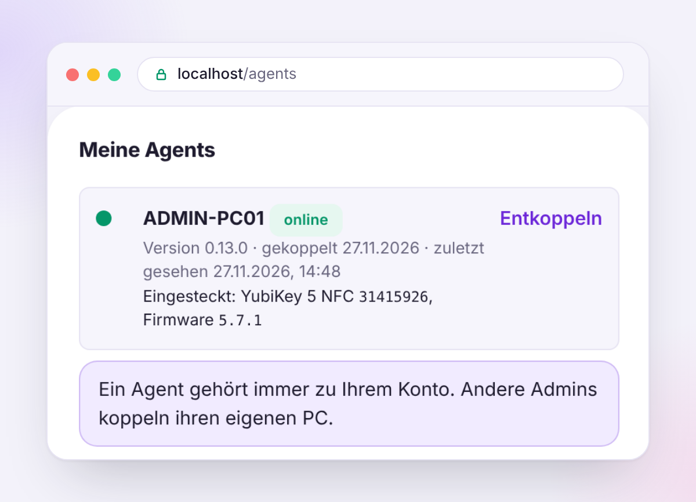
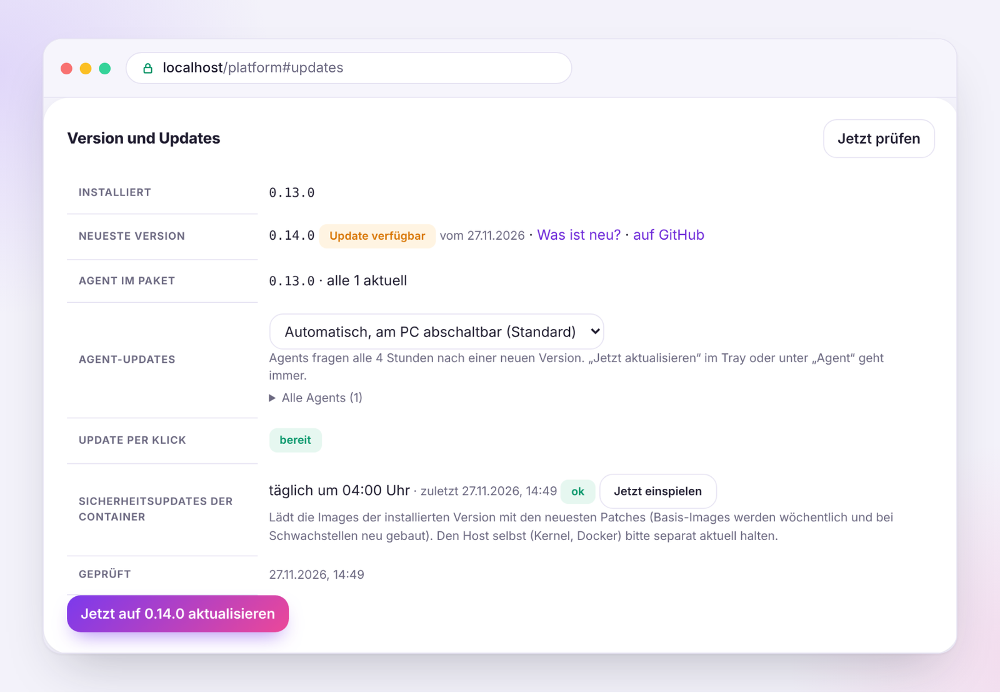

# Installation in vier Schritten

Diese Anleitung bringt den Yubikey Lifecycle Manager auf einem Windows-PC zum Laufen. Sie brauchen dafür etwa 15 Minuten. Für den Betrieb auf einem Linux-Server im Firmennetz steht unten ein [Abschnitt](#auf-einem-server-installieren).

<picture>
  <source media="(prefers-color-scheme: dark)" srcset="bilder/installation/ablauf-dark.gif">
  
</picture>

## Was Sie brauchen

| | |
|---|---|
| **Windows 10 oder 11** | mit lokalen Administratorrechten |
| **[Docker Desktop](https://www.docker.com/products/docker-desktop/)** | installiert und gestartet |
| **Microsoft-Entra-Konto** | Globaler Administrator Ihres Tenants, nur für die Einrichtung |
| **YubiKey 5** | zum Testen am besten ein Key ohne wichtige Passkeys |

## 1. Server starten

PowerShell öffnen (keine Administratorrechte nötig) und diesen Befehl einfügen:

```powershell
irm https://raw.githubusercontent.com/PanPakaPancake/Yubikey-Lifecycle-Manager/main/install.ps1 | iex
```



Das Skript lädt die fertigen Container und startet alles. Zwischendurch fragt Windows einmal per UAC, ob ein Zertifikat eingetragen werden darf: **mit Ja bestätigen**. Damit vertrauen Browser und Agent der Adresse `https://localhost`.

Am Ende stehen zwei Werte im Fenster:

- das **Setup-Token**: Das brauchen Sie gleich im Browser.
- die **Passphrase der Datensicherung**: jetzt in den Passwortmanager übernehmen. Ohne sie lässt sich keine Sicherung wieder einspielen.

Der Browser öffnet sich danach von selbst.

## 2. Einrichten

Im Browser unter `https://localhost/setup` führt ein Assistent durch vier kurze Schritte.

**Setup-Token** aus dem PowerShell-Fenster einfügen und auf **Weiter** klicken.

<picture>
  <source media="(prefers-color-scheme: dark)" srcset="bilder/installation/einrichtung-1-dark.png">
  
</picture>

**Grunddaten:** den Namen Ihrer Organisation eintragen. Die Adresse `https://localhost` ist schon richtig.

<picture>
  <source media="(prefers-color-scheme: dark)" srcset="bilder/installation/einrichtung-2-dark.png">
  
</picture>

**Bei Microsoft anmelden** klicken und mit dem Globalen Administrator anmelden. Die Plattform legt danach alles Nötige in Entra selbst an: App-Registrierung, Zertifikat und Berechtigungen. Das dauert bis zu zwei Minuten.

<picture>
  <source media="(prefers-color-scheme: dark)" srcset="bilder/installation/einrichtung-3-dark.png">
  
</picture>

Im letzten Schritt bestätigen Sie sich als ersten Owner und melden sich mit Ihrem YubiKey an. Danach empfiehlt die Plattform, unter **Mein Konto → Notfallcodes** gleich Notfallcodes auszudrucken.

> Sperrt Ihr Tenant diese Anmeldung, steht im Assistenten unter „Alternativ“ ein PowerShell-Skript als Ausweichweg. Details: [Betrieb, Abschnitt 2](BETRIEB.md#2-einrichtung-einmalig).

## 3. Agent installieren

Der Agent ist ein kleines Windows-Programm. Er spricht mit dem eingesteckten YubiKey, was ein Browser allein nicht kann.

In der Oberfläche links auf **Mein Agent** gehen, **Agent herunterladen** klicken und das MSI mit Doppelklick installieren. Danach erscheint unten rechts in der Taskleiste das Tray-Symbol.

<picture>
  <source media="(prefers-color-scheme: dark)" srcset="bilder/installation/agent-herunterladen-dark.png">
  
</picture>

> Solange das MSI noch nicht signiert ist, warnt Windows SmartScreen. Dann auf „Weitere Informationen“ und „Trotzdem ausführen“ klicken.

## 4. Koppeln

Damit der Agent weiß, zu welcher Plattform er gehört, wird er einmal gekoppelt:

1. Auf der Seite **Mein Agent** auf **Kopplungscode erzeugen** klicken.
2. Rechtsklick auf das Tray-Symbol und **Koppeln …** wählen.
3. Als Server-Adresse `https://localhost` und dazu den Code eingeben. Die Adresse ist immer genau die aus der Adresszeile des Browsers.

<picture>
  <source media="(prefers-color-scheme: dark)" srcset="bilder/installation/koppeln-dark.gif">
  
</picture>

Wenn das geklappt hat, steht im Tray **Verbunden** und auf der Seite **Mein Agent** Ihr PC mit dem Hinweis **online**. Stecken Sie einen YubiKey ein, erscheinen Modell, Seriennummer und Firmware.

<picture>
  <source media="(prefers-color-scheme: dark)" srcset="bilder/installation/agent-verbunden-dark.png">
  
</picture>

**Fertig.** Als Nächstes unter **Tenants** den ersten Kunden-Tenant anbinden (wenn Sie den eigenen nicht schon im Assistenten angebunden haben) und unter **Registrieren** den ersten Key einrichten.

## Aktuell bleiben

Neue Versionen meldet die Plattform selbst: Ein Punkt neben **Globale Einstellungen** zeigt sie an. Unter **Globale Einstellungen → Updates** genügt dann ein Klick auf **Jetzt auf … aktualisieren**. Die Agents auf den PCs aktualisieren sich danach von allein.

<picture>
  <source media="(prefers-color-scheme: dark)" srcset="bilder/installation/updates-dark.png">
  
</picture>

Ab und zu lohnt es sich, den Befehl aus Schritt 1 noch einmal auszuführen. Er bringt auch die Konfigurationsdateien auf den neuesten Stand. Daten und Einstellungen bleiben dabei erhalten.

## Wenn etwas nicht klappt

| Problem | Lösung |
|---|---|
| Der Browser warnt vor dem Zertifikat. | Die UAC-Abfrage wurde abgelehnt. Als Administrator ausführen: `certutil -addstore Root "$env:USERPROFILE\YubikeyLifecycleManager\ylm-root-ca.crt"` |
| Das Setup-Token ist weg. | Im Ordner `%USERPROFILE%\YubikeyLifecycleManager`: `docker compose logs server \| findstr Setup-Token` |
| Der Tray meldet beim Koppeln einen Fehler. | Die Adresse genau wie im Browser eingeben, also `https://localhost` ohne Port. Port 8080 ist nur intern. Koppeln darf nur ein Konto, das auf dem PC lokaler Administrator ist. |
| Der Tray zeigt „Kopplung ungültig – neu koppeln“. | Der Agent wurde in der Oberfläche entfernt oder die Plattform neu installiert. Einen neuen Code erzeugen und neu koppeln. |
| Die Plattform startet nicht. | Läuft Docker Desktop? Im Installationsordner `docker compose ps` und `docker compose logs server` ansehen. |

Weitere Hilfe und Fehlermeldungen bitte als [Issue auf GitHub](https://github.com/PanPakaPancake/Yubikey-Lifecycle-Manager/issues).

## Auf einem Server installieren

Für den Dauerbetrieb im Team gehört die Plattform auf einen Linux-Server im internen Netz oder hinter einen geschützten Zugang (ZTNA, VPN). Der Befehl dafür:

```bash
curl -fsSL https://raw.githubusercontent.com/PanPakaPancake/Yubikey-Lifecycle-Manager/main/install.sh | sudo bash
```

Das Skript fragt nach der Variante (interne Zertifizierungsstelle, eigenes Zertifikat oder vorhandener Reverse Proxy) und dem DNS-Namen. Danach geht es wie oben ab Schritt 2 weiter, nur mit der Adresse des Servers statt `https://localhost`.

Alle Varianten, Datensicherung, Umzug und Einstellungen stehen in [Betrieb und Installation](BETRIEB.md).
